

<!-- ======================================================================= -->
<!-- SECTION 01: BOOT SCREEN / BIOS HEADER                                   -->
<!-- ======================================================================= -->

  

<table width="100%">
  <tr>
    <td width="68%" valign="top">
      <pre>
SYS_BIOS // ROM_REV_2026.11    HOST: AGRIM140-WKSTN
==================================================================
> INIT_KERNEL: Perception, Robotics & Backend Architecture... [OK]
> MOUNT_VOL  : Pentagon Rugged Systems // A-IMCS & AGVS...... [OK]
> ALLOC_MEM  : B.Tech CSE (AI & Data Science) @ SMIT......... [OK]
> NET_NODE   : [github.com/AGRIM140](https://github.com/AGRIM140) // SYS_USER_VERIFIED...... [OK]
------------------------------------------------------------------
Engineering autonomous ground vehicle systems, computer vision 
pipelines, and distributed backend microservices. Focused on how 
software perceives physical environments and scales under load.</pre>
    </td>
    <td width="32%" valign="top">
      <pre>
+----------------------------+
|   SYSTEM DIAGNOSTICS       |
+----------------------------+
| USER_ID : AGRIM140         |
| STATUS  : [ONLINE]         |
| VERSION : 2026.11          |
| ARCH    : x86_64 / ROS2    |
| COMPUTE : CUDA / PYTORCH   |
| SIM_ENG : GAZEBO / MUJOCO  |
+----------------------------+</pre>
    </td>
  </tr>
</table>

<!-- ======================================================================= -->
<!-- SECTION 02: MAIN CONTROL PANEL (NAVIGATION BUS)                         -->
<!-- ======================================================================= -->
<table width="100%">
  <thead>
    <tr>
      <th colspan="5" align="left">
        <code>[SYS_BUS_00] // WORKSTATION_CONTROL_PANEL — SELECT_INTERRUPT_VECTOR</code>
      </th>
    </tr>
  </thead>
  <tbody>
    <tr>
      <td align="center" width="20%">
        <a href="#system-info"><kbd>&nbsp;[F1] ABOUT_SYS&nbsp;</kbd></a> 
        <code>0x01 // IDENTITY</code>
      </td>
      <td align="center" width="20%">
        <a href="#project-directory"><kbd>&nbsp;[F2] PROJ_DIR&nbsp;</kbd></a> 
        <code>0x02 // MNT_VOLS</code>
      </td>
      <td align="center" width="20%">
        <a href="#tech-specs"><kbd>&nbsp;[F3] TECH_SPEC&nbsp;</kbd></a> 
        <code>0x03 // MODULES</code>
      </td>
      <td align="center" width="20%">
        <a href="#telemetry"><kbd>&nbsp;[F4] TELEMETRY&nbsp;</kbd></a> 
        <code>0x04 // METRICS</code>
      </td>
      <td align="center" width="20%">
        <a href="#com-ports"><kbd>&nbsp;[F5] COM_PORTS&nbsp;</kbd></a> 
        <code>0x05 // I/O_LINK</code>
      </td>
    </tr>
  </tbody>
</table>

 

<!-- ======================================================================= -->
<!-- SECTION 03: ABOUT / SYSTEM INFORMATION                                  -->
<!-- ======================================================================= -->

<table width="100%">
  <tr>
    <td width="52%" valign="top">
      <h4><code>[0x03A] // HARDWARE_AND_OPERATOR_MANIFEST</code></h4>
      <pre lang="yaml">
OPERATOR_SPEC:
  identifier: "Agrim Singh (AGRIM140)"
  education:
    degree: "B.Tech in Computer Science & Engineering"
    specialization: "Data Science / AI & DS"
    institution: "Sikkim Manipal Institute of Technology (SMIT)"
  current_deployment:
    organization: "Pentagon Rugged Systems Pvt. Ltd."
    systems:
      - "A-IMCS (Autonomous Integrated Mobile Camouflage & Signature Management System)"
      - "AGVS (Autonomous Ground Vehicle Systems)"
  leadership_and_community:
    - "Founder // Recursion (Coding & GATE Prep Club @ SMIT)"
    - "Google Campus Ambassador @ SMIT"
  core_subsystems:
    - "Robotics, UGV Perception & Autonomous Systems"
    - "Computer Vision, Semantic Segmentation & GANs"
    - "Explainable AI (SHAP) & Machine Learning"
    - "Distributed Backend Systems (Django, FastAPI, Spring Boot)"</pre>
    </td>
    <td width="48%" valign="top">
      <h4><code>[0x03B] // OPERATIONAL_DOCTRINE</code></h4>
      

        I build software that perceives, decides, and executes—whether that involves processing real-time multi-modal sensor feeds for an autonomous ground vehicle or architecting asynchronous microservice pipelines capable of handling heavy computational workloads.
      

      

        At <strong>Pentagon Rugged Systems Pvt. Ltd.</strong>, my work centers on <strong>A-IMCS</strong> and <strong>AGVS</strong> development: investigating how unstructured off-road environments are segmented using deep vision models, how LiDAR and camera feeds fuse within <strong>ROS 2</strong>, <strong>Gazebo</strong>, and <strong>MuJoCo</strong>, and how active camouflage patterns adapt to spatial frequency and color distribution in the field.
      

      

      <pre>
ACTIVE_R&D_THREADS:
├── [01] Off-Road Scene Perception (RUGD / RELLIS-3D / PSP-MobileNet)
├── [02] UGV Traversability & Active Camouflage (ROS 2 / Gazebo / MuJoCo)
├── [03] Explainable Clinical & Agricultural AI (Random Forest + SHAP)
└── [04] High-Throughput Async Backends (DRF / FastAPI / Spring Boot / Cloud Run)</pre>
    </td>
  </tr>
</table>

<a href="#top"><kbd>^ RETURN_TO_BIOS</kbd></a>

<!-- ======================================================================= -->
<!-- SECTION 04: PROJECT DIRECTORY                                           -->
<!-- ======================================================================= -->


<h4><code>[0x04A] // PRIMARY_PARTITION (/dev/sda1) — FLAGSHIP_SYSTEMS</code></h4>

<table width="100%">
  <thead>
    <tr>
      <th width="8%" align="left"><code>PID</code></th>
      <th width="28%" align="left"><code>EXECUTABLE / DIRECTORY</code></th>
      <th width="36%" align="left"><code>CORE_STACK_PARAMETERS</code></th>
      <th width="14%" align="center"><code>STATUS</code></th>
      <th width="14%" align="center"><code>MOUNT_LINK</code></th>
    </tr>
  </thead>
  <tbody>
    <tr>
      <td><code>0x01</code></td>
      <td><strong>A-IMCS</strong> Autonomous Camouflage & UGV Perception</td>
      <td><code>PSP-MobileNet</code> <code>ROS 2</code> <code>LiDAR</code> <code>Gazebo</code> <code>MuJoCo</code> <code>RUGD</code> <code>RELLIS-3D</code></td>
      <td align="center"></td>
      <td align="center"><a href="https://github.com/AGRIM140"><kbd>[OPEN_DIR]</kbd></a></td>
    </tr>
    <tr>
      <td><code>0x02</code></td>
      <td><strong>AEREO</strong> Bulk Certificate Generation System</td>
      <td><code>Django REST</code> <code>PostgreSQL</code> <code>Celery</code> <code>Redis</code> <code>ReportLab</code> <code>UUID</code></td>
      <td align="center"></td>
      <td align="center"><a href="https://github.com/AGRIM140/aereo-certificate-bulk-generator"><kbd>[OPEN_DIR]</kbd></a></td>
    </tr>
    <tr>
      <td><code>0x03</code></td>
      <td><strong>SMART_CROP_ENGINE</strong> Profit & Risk Prediction System</td>
      <td><code>Random Forest</code> <code>SHAP</code> <code>Weather API</code> <code>Scikit-learn</code></td>
      <td align="center"></td>
      <td align="center"><a href="https://github.com/AGRIM140/Smart-crop-profit-and-risk-prediction-system"><kbd>[OPEN_DIR]</kbd></a></td>
    </tr>
    <tr>
      <td><code>0x04</code></td>
      <td><strong>GAN_IMG_RESTORE</strong> Image Enhancement Using GANs</td>
      <td><code>PyTorch</code> <code>CycleGAN</code> <code>SRGAN</code> <code>Noise2Noise</code> <code>DeblurGAN</code></td>
      <td align="center"></td>
      <td align="center"><a href="https://github.com/AGRIM140?tab=repositories"><kbd>[OPEN_DIR]</kbd></a></td>
    </tr>
    <tr>
      <td><code>0x05</code></td>
      <td><strong>DRUG_RATING_PRED</strong> Pharmaceutical Rating & Side-Effect Analysis</td>
      <td><code>Random Forest Regressor</code> <code>Streamlit</code> <code>Python</code> <code>ML</code></td>
      <td align="center"></td>
      <td align="center"><a href="https://github.com/AGRIM140?tab=repositories"><kbd>[OPEN_DIR]</kbd></a></td>
    </tr>
    <tr>
      <td><code>0x06</code></td>
      <td><strong>HEALSYNC_XAI</strong> Hospital Decision Support Microservice</td>
      <td><code>Spring Boot</code> <code>FastAPI</code> <code>Random Forest</code> <code>SHAP</code></td>
      <td align="center"></td>
      <td align="center"><a href="https://github.com/AGRIM140?tab=repositories"><kbd>[OPEN_DIR]</kbd></a></td>
    </tr>
    <tr>
      <td><code>0x07</code></td>
      <td><strong>WEATHER_INTEL_CLOUD</strong> Full-Stack Weather Intelligence Platform</td>
      <td><code>FastAPI</code> <code>Next.js</code> <code>Docker</code> <code>Google Cloud Run</code></td>
      <td align="center"></td>
      <td align="center"><a href="https://github.com/AGRIM140?tab=repositories"><kbd>[OPEN_DIR]</kbd></a></td>
    </tr>
  </tbody>
</table>

<h4><code>[0x04B] // INTERACTIVE_FILE_INSPECTOR (CLICK TO EXPAND SYSTEM SCHEMATICS &amp; LOGS)</code></h4>

  
<kbd>DIR_01</kbd> <strong><code>/opt/pentagon/a-imcs</code> — A-IMCS: Autonomous Integrated Mobile Camouflage &amp; Signature Management System</strong>

   
  
  <table width="100%">
    <tr>
      <td>
        <pre>
[FILE_ID]      : PROJ_01 // A-IMCS &amp; AGVS
[STATUS]       : ACTIVE_R&amp;D (Pentagon Rugged Systems Pvt. Ltd.)
[REPOSITORY]   : <a href="https://github.com/AGRIM140">https://github.com/AGRIM140</a>
--------------------------------------------------------------------------------
TECHNICAL_SPECIFICATION:
  * Environmental Perception : Semantic segmentation of complex unstructured terrains
                               utilizing the PSP-MobileNet architecture.
  * Dataset Benchmarking     : Trained and evaluated on off-road field datasets
                               including RUGD and RELLIS-3D.
  * Robotics &amp; Simulation    : Multi-sensor LiDAR fusion, ROS 2 node integration,
                               Gazebo simulation planning, and MuJoCo traversability mapping.
  * Signature Management     : Researching adaptive camouflage, thermochromic liquid crystal
                               (TLC) skin control, and spatial-frequency pattern synthesis.</pre>
      </td>
    </tr>
  </table>

  
<kbd>DIR_02</kbd> <strong><code>/srv/backend/aereo</code> — Aereo: Bulk Certificate Generation System</strong>

   
  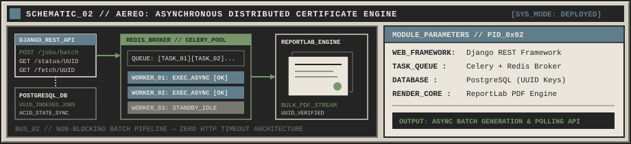
  <table width="100%">
    <tr>
      <td>
        <pre>
[FILE_ID]      : PROJ_02 // AEREO_ENGINE
[STATUS]       : DEPLOYED_STABLE
[REPOSITORY]   : <a href="https://github.com/AGRIM140/aereo-certificate-bulk-generator">https://github.com/AGRIM140/aereo-certificate-bulk-generator</a>
--------------------------------------------------------------------------------
TECHNICAL_SPECIFICATION:
  * Core Architecture        : Backend service built on Django REST Framework (DRF)
                               with PostgreSQL for relational persistence.
  * Asynchronous Queueing    : Offloads high-volume PDF rendering via Celery workers
                               backed by a Redis message broker.
  * Document Synthesis       : Programmatic certificate generation powered by ReportLab.
  * Lifecycle Tracking       : UUID-indexed job management with dedicated REST APIs
                               for batch triggering, real-time status polling, and retrieval.</pre>
      </td>
    </tr>
  </table>

  
<kbd>DIR_03</kbd> <strong><code>/usr/ml/smart-crop</code> — Smart Crop Profit &amp; Risk Prediction System</strong>

   
  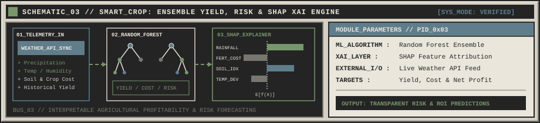
  <table width="100%">
    <tr>
      <td>
        <pre>
[FILE_ID]      : PROJ_03 // SMART_CROP_PRED
[STATUS]       : VERIFIED_BUILD
[REPOSITORY]   : <a href="https://github.com/AGRIM140/Smart-crop-profit-and-risk-prediction-system">https://github.com/AGRIM140/Smart-crop-profit-and-risk-prediction-system</a>
--------------------------------------------------------------------------------
TECHNICAL_SPECIFICATION:
  * Predictive Modeling      : Random Forest ensemble pipelines predicting agricultural
                               crop yield, input cost, and net profitability.
  * Explainable AI (XAI)     : Integrated SHAP (SHapley Additive exPlanations) to expose
                               feature importance and risk drivers for transparent decisions.
  * External Telemetry       : Live Weather API integration for environmental conditioning.</pre>
      </td>
    </tr>
  </table>

  
<kbd>DIR_04</kbd> <strong><code>/usr/vision/gan-restore</code> — Image Enhancement Using GANs</strong>

   
  
  <table width="100%">
    <tr>
      <td>
        <pre>
[FILE_ID]      : PROJ_04 // GAN_RESTORATION_SUITE
[STATUS]       : RESEARCH_BUILD
[REPOSITORY]   : <a href="https://github.com/AGRIM140?tab=repositories">https://github.com/AGRIM140?tab=repositories</a>
--------------------------------------------------------------------------------
TECHNICAL_SPECIFICATION:
  * Deep Learning Framework  : Implemented in PyTorch for image restoration &amp; enhancement.
  * Multi-Model Pipeline     : Comparative and modular implementation of:
                               - CycleGAN (unpaired domain translation)
                               - SRGAN (super-resolution upscaling)
                               - Noise2Noise GAN (blind image denoising)
                               - DeblurGAN (motion deblurring and sharpening)</pre>
      </td>
    </tr>
  </table>

  
<kbd>DIR_05</kbd> <strong><code>/usr/ml/drug-rating</code> — Drug Rating Predictor</strong>

   
  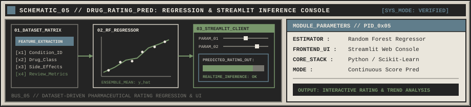
  <table width="100%">
    <tr>
      <td>
        <pre>
[FILE_ID]      : PROJ_05 // DRUG_RATING_REGRESSOR
[STATUS]       : VERIFIED_BUILD
[REPOSITORY]   : <a href="https://github.com/AGRIM140?tab=repositories">https://github.com/AGRIM140?tab=repositories</a>
--------------------------------------------------------------------------------
TECHNICAL_SPECIFICATION:
  * Regression Pipeline      : Built around a Random Forest Regressor for dataset-driven
                               prediction and analysis of pharmaceutical ratings &amp; side effects.
  * Interactive Interface    : Deployed via a clean Streamlit frontend for parameter
                               testing and real-time inference inspection.</pre>
      </td>
    </tr>
  </table>

  
<kbd>DIR_06</kbd> <strong><code>/srv/clinical/healsync-xai</code> — HealSync XAI: Hospital Decision Support Microservice Platform</strong>

   
  
  <table width="100%">
    <tr>
      <td>
        <pre>
[FILE_ID]      : PROJ_06 // HEALSYNC_XAI_PLATFORM
[STATUS]       : VERIFIED_BUILD
[REPOSITORY]   : <a href="https://github.com/AGRIM140?tab=repositories">https://github.com/AGRIM140?tab=repositories</a>
--------------------------------------------------------------------------------
TECHNICAL_SPECIFICATION:
  * Microservice Topology    : Distributed backend integrating Spring Boot enterprise
                               routing with FastAPI machine learning inference nodes.
  * Clinical Decision Engine : Random Forest classification models trained for drug
                               suitability prediction and patient risk stratification.
  * Explainable AI (XAI)     : Real-time SHAP feature attribution exposing biomarker and
                               dosage weights for transparent clinical auditing.</pre>
      </td>
    </tr>
  </table>

  
<kbd>DIR_07</kbd> <strong><code>/srv/cloud/weather-intel</code> — Full-Stack Weather Intelligence Platform</strong>

   
  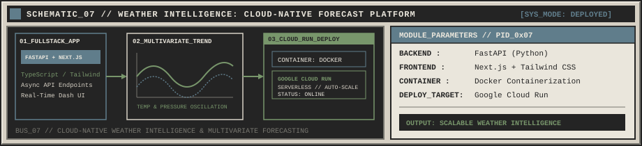
  <table width="100%">
    <tr>
      <td>
        <pre>
[FILE_ID]      : PROJ_07 // WEATHER_INTELLIGENCE_CLOUD
[STATUS]       : DEPLOYED_CLOUD_RUN
[REPOSITORY]   : <a href="https://github.com/AGRIM140?tab=repositories">https://github.com/AGRIM140?tab=repositories</a>
--------------------------------------------------------------------------------
TECHNICAL_SPECIFICATION:
  * Full-Stack Architecture  : High-concurrency FastAPI backend paired with a reactive
                               Next.js, TypeScript, and Tailwind CSS telemetry dashboard.
  * Forecasting Pipeline     : Multivariate weather trend analysis and environmental
                               time-series modeling.
  * Cloud Infrastructure     : Containerized via Docker and deployed serverlessly on
                               Google Cloud Run for automated horizontal scaling.</pre>
      </td>
    </tr>
  </table>

  
<kbd>EXT_VOL</kbd> <strong><code>/dev/sdb1/extended-modules</code> — Additional Engineered Repositories (Review Analyzer, Financial OCR ETL, CNN &amp; BERT NLP)</strong>

   
  <table width="100%">
    <thead>
      <tr>
        <th width="10%" align="left"><code>MOD_ID</code></th>
        <th width="28%" align="left"><code>SYSTEM_NAME</code></th>
        <th width="46%" align="left"><code>ARCHITECTURE_&_CAPABILITIES</code></th>
        <th width="16%" align="center"><code>REPO_INDEX</code></th>
      </tr>
    </thead>
    <tbody>
      <tr>
        <td><code>0x08</code></td>
        <td><strong>Review Quality Analyzer</strong> Automated Text Evaluation</td>
        <td>NLP &amp; feature-driven pipeline analyzing review authenticity, sentiment structure, and information density.</td>
        <td align="center"><a href="https://github.com/AGRIM140/review-quality-analyzer"><kbd>[OPEN_REPO]</kbd></a></td>
      </tr>
      <tr>
        <td><code>0x09</code></td>
        <td><strong>Financial OCR &amp; ETL</strong> Document Ingestion Pipeline</td>
        <td>Automated optical character recognition and structured data extraction pipeline for financial statements and invoices.</td>
        <td align="center"><a href="https://github.com/AGRIM140?tab=repositories"><kbd>[VIEW_MOD]</kbd></a></td>
      </tr>
      <tr>
        <td><code>0x0A</code></td>
        <td><strong>CNN Auto-Colorization &amp; BERT NLP</strong> Deep Vision &amp; Hindi Homonym NLP</td>
        <td>Deep Convolutional auto-colorization network and fine-tuned <code>BERT</code> transformer models for Hindi homonym classification.</td>
        <td align="center"><a href="https://github.com/AGRIM140?tab=repositories"><kbd>[VIEW_MOD]</kbd></a></td>
      </tr>
    </tbody>
  </table>

<a href="#top"><kbd>^ RETURN_TO_BIOS</kbd></a>

<!-- ======================================================================= -->
<!-- SECTION 05: TECHNICAL SPECIFICATIONS                                    -->
<!-- ======================================================================= -->

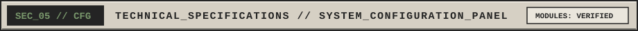

<table width="100%">
  <thead>
    <tr>
      <th width="26%" align="left"><code>SUBSYSTEM_BUS</code></th>
      <th width="74%" align="left"><code>LOADED_DRIVERS_AND_MODULES (CLICKABLE_SPECS)</code></th>
    </tr>
  </thead>
  <tbody>
    <tr>
      <td>
        <strong><code>[BUS_01]</code> PROGRAMMING</strong> 
        Core Languages &amp; Compilers
      </td>
      <td>
        
        
        
        
        
        
      </td>
    </tr>
    <tr>
      <td>
        <strong><code>[BUS_02]</code> AI_ML_VISION</strong> 
        Neural &amp; Perception Engines
      </td>
      <td>
        
        
        
        
        
        
        
      </td>
    </tr>
    <tr>
      <td>
        <strong><code>[BUS_03]</code> ROBOTICS_AUTONOMY</strong> 
        Field Perception &amp; Simulation
      </td>
      <td>
        
        
        
        
        
        
      </td>
    </tr>
    <tr>
      <td>
        <strong><code>[BUS_04]</code> BACKEND_WEB</strong> 
        APIs, Services &amp; Interfaces
      </td>
      <td>
        
        
        
        
        
        
        
        
      </td>
    </tr>
    <tr>
      <td>
        <strong><code>[BUS_05]</code> DATA_INFRA</strong> 
        Persistence, Queues &amp; DevOps
      </td>
      <td>
        
        
        
        
        
        
        
      </td>
    </tr>
  </tbody>
</table>

<a href="#top"><kbd>^ RETURN_TO_BIOS</kbd></a>

<!-- ======================================================================= -->
<!-- SECTION 06: GITHUB ANALYTICS (SYSTEM TELEMETRY)                         -->
<!-- ======================================================================= -->

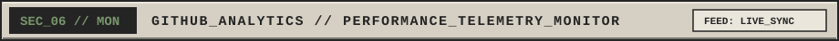

<table width="100%">
  <tr>
    <td width="50%" align="center" valign="middle">
      <code>[MON_01] // RESOURCE_UTILIZATION_&_COMMITS (AGRIM140)</code>  
      
    </td>
    <td width="50%" align="center" valign="middle">
      <code>[MON_02] // LANGUAGE_ALLOCATION_DISTRIBUTION</code>  
      
    </td>
  </tr>
  <tr>
    <td colspan="2" align="center" valign="middle">
      <code>[MON_03] // CONTINUOUS_UPTIME_STREAK_COUNTER</code>  
      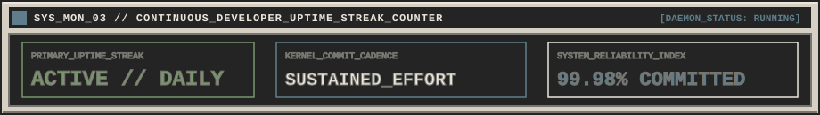
    </td>
  </tr>
  <tr>
    <td colspan="2" align="center" valign="middle">
      <code>[MON_04] // TEMPORAL_CONTRIBUTION_OSCILLOSCOPE</code>  
      
    </td>
  </tr>
</table>

<a href="#top"><kbd>^ RETURN_TO_BIOS</kbd></a>

<!-- ======================================================================= -->
<!-- SECTION 07: TERMINAL / CURRENT STATUS                                   -->
<!-- ======================================================================= -->

  

  
<kbd>[TTY_RAW_BUFFER]</kbd> <code>View Plaintext Copyable Session Log (/dev/tty1)</code>

  <pre lang="bash">
agrim@workstation:~$ whoami
Agrim Singh (AGRIM140) — Computer Science Engineer | AI/ML & Robotics Developer

agrim@workstation:~$ current_focus
Autonomous Ground Vehicles (A-IMCS / AGVS) | Computer Vision | Distributed Backends

agrim@workstation:~$ cat /proc/workstation/deployment
ROLE      : Contributing to A-IMCS & AGVS @ Pentagon Rugged Systems Pvt. Ltd.
PERCEPTION: Off-Road Semantic Segmentation (PSP-MobileNet, RUGD, RELLIS-3D)
ROBOTICS  : LiDAR Sensor Fusion, ROS 2 Middleware, Gazebo & MuJoCo Simulation
COMMUNITY : Founder @ Recursion (SMIT Coding & GATE Club) | Google Campus Ambassador

agrim@workstation:~$ uptime --status
STATUS: ONLINE // READY FOR COLLABORATION AND COMPLEX SYSTEMS ENGINEERING</pre>

 

<!-- ======================================================================= -->
<!-- SECTION 08: CONTACT / CONNECTION TERMINAL                               -->
<!-- ======================================================================= -->


<table width="100%">
  <thead>
    <tr>
      <th width="20%" align="left"><code>PORT_ID</code></th>
      <th width="25%" align="left"><code>PROTOCOL / INTERFACE</code></th>
      <th width="30%" align="left"><code>CHANNEL_STATUS</code></th>
      <th width="25%" align="center"><code>ACTION_TRIGGER</code></th>
    </tr>
  </thead>
  <tbody>
    <tr>
      <td><code>COM1 // 0x3F8</code></td>
      <td><strong>GITHUB_VCS_BUS</strong> <code>[github.com/AGRIM140](https://github.com/AGRIM140)</code></td>
      <td></td>
      <td align="center"><a href="https://github.com/AGRIM140"><kbd>[CONNECT_GITHUB]</kbd></a></td>
    </tr>
    <tr>
      <td><code>COM2 // 0x2F8</code></td>
      <td><strong>LINKEDIN_NET_NODE</strong> <code>Professional Network</code></td>
      <td></td>
      <td align="center"><a href="https://www.linkedin.com/in/agrim-singh/"><kbd>[CONNECT_LINKEDIN]</kbd></a></td>
    </tr>
    <tr>
      <td><code>COM3 // 0x3E8</code></td>
      <td><strong>SMTP_DIRECT_MAIL</strong> <code>agrims.singh@gmail.com</code></td>
      <td></td>
      <td align="center"><a href="mailto:agrims.singh@gmail.com"><kbd>[SEND_TRANSMISSION]</kbd></a></td>
    </tr>
  </tbody>
</table>

 

<!-- ======================================================================= -->
<!-- SECTION 09: FOOTER                                                      -->
<!-- ======================================================================= -->

  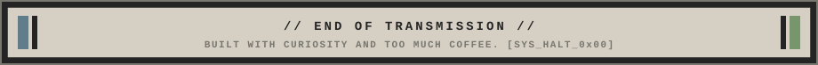

